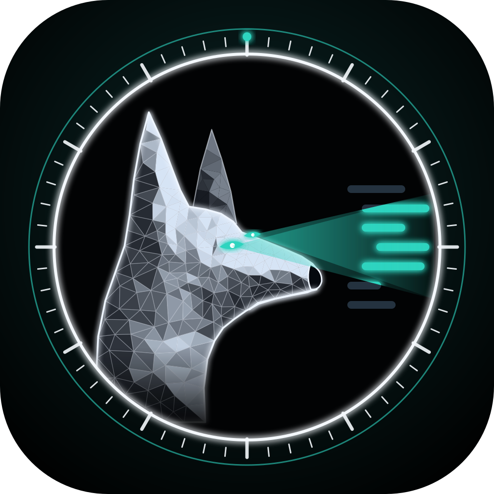

# Watchdog Lab

### Autonomous code needs autonomous security.

A pack of 14 security dogs for Claude Code and GitHub. Each one guards one part of your product, 
flags the risky line as it's written, and audits the whole repo in one command.

 

## 🧭 Philosophy

- **Always on guard** — security runs while you build, not after. Every change gets watched the moment it's written.
- **Fix, not fear** — every finding comes with the line, why it matters, and the smallest fix.
- **Safe by design** — static by default, read-only in CI, and secrets are never printed.

## 🐕 Meet the pack

<table>
  <tr>
    <td align="center" width="14%"><a href="https://github.com/watchdoglab/watchdog/blob/main/docs/malinois.md"> <b>Malinois</b></a> VAPT</td>
    <td align="center" width="14%"><a href="https://github.com/watchdoglab/watchdog/blob/main/docs/bloodhound.md"> <b>Bloodhound</b></a> API</td>
    <td align="center" width="14%"><a href="https://github.com/watchdoglab/watchdog/blob/main/docs/doberman.md"> <b>Doberman</b></a> Auth</td>
    <td align="center" width="14%"><a href="https://github.com/watchdoglab/watchdog/blob/main/docs/pointer.md"> <b>Pointer</b></a> Frontend</td>
    <td align="center" width="14%"><a href="https://github.com/watchdoglab/watchdog/blob/main/docs/dachshund.md"> <b>Dachshund</b></a> Database</td>
    <td align="center" width="14%"><a href="https://github.com/watchdoglab/watchdog/blob/main/docs/akita.md"> <b>Akita</b></a> Secrets</td>
    <td align="center" width="14%"><a href="https://github.com/watchdoglab/watchdog/blob/main/docs/rottweiler.md"> <b>Rottweiler</b></a> Supply chain</td>
  </tr>
  <tr>
    <td align="center" width="14%"><a href="https://github.com/watchdoglab/watchdog/blob/main/docs/collie.md"> <b>Collie</b></a> AI & agents</td>
    <td align="center" width="14%"><a href="https://github.com/watchdoglab/watchdog/blob/main/docs/husky.md"> <b>Husky</b></a> Cloud</td>
    <td align="center" width="14%"><a href="https://github.com/watchdoglab/watchdog/blob/main/docs/shepherd.md"> <b>Shepherd</b></a> Mobile</td>
    <td align="center" width="14%"><a href="https://github.com/watchdoglab/watchdog/blob/main/docs/beagle.md"> <b>Beagle</b></a> Privacy</td>
    <td align="center" width="14%"><a href="https://github.com/watchdoglab/watchdog/blob/main/docs/shiba.md"> <b>Shiba</b></a> Web3</td>
    <td align="center" width="14%"><a href="https://github.com/watchdoglab/watchdog/blob/main/docs/pyrenees.md"> <b>Pyrenees</b></a> Compliance</td>
    <td align="center" width="14%"><a href="https://github.com/watchdoglab/watchdog/blob/main/docs/saintbernard.md"> <b>Saint Bernard</b></a> Incidents</td>
  </tr>
</table>

 

## 🧰 Products

<table>
  <tr>
    <td width="50%" valign="top">
      <h3>🛡️ <a href="https://github.com/watchdoglab/watchdog">Watchdog for Claude Code</a></h3>
      
The dogs watch every change while you code and run full audits on demand: Critical → Low, each with <code>file:line</code>, how it's exploited and the smallest fix.

<pre>/plugin marketplace add watchdoglab/watchdog
/plugin install watchdog@watchdog</pre>
      
    </td>
    <td width="50%" valign="top">
      <h3>🔍 <a href="https://github.com/watchdoglab/watchdog-action">Watchdog PR Review</a></h3>
      
A security reviewer on every pull request. Inline comments with one-click fixes, then a summary. Works with Claude, Codex, Gemini or any OpenRouter model.

<pre>- uses: watchdoglab/watchdog-action@v1
  with:
    anthropic_api_key: ${{ secrets.ANTHROPIC_API_KEY }}</pre>
      
    </td>
  </tr>
</table>

## ✨ Why teams use it

- **Catches bugs while you code** — not weeks later in a pen-test report.
- **Speaks plain English** — every finding says what it is, how it's abused and how to fix it.
- **Honest about its limits** — every report ends with what it *didn't* check.
- **Never leaks what it finds** — secrets are reported by location and type, never the value.
- **Static by default** — active testing only on targets you put in scope.

 

<a href="https://watchdoglab.github.io"><b>Website</b></a> ·
<a href="https://watchdoglab.github.io/#pack"><b>Meet the dogs</b></a> ·
<a href="https://github.com/watchdoglab/watchdog#readme"><b>Docs</b></a> ·
<a href="https://github.com/watchdoglab/watchdog/issues"><b>Report an issue</b></a>

Built for builders who ship fast and still want to sleep at night. 🐾

